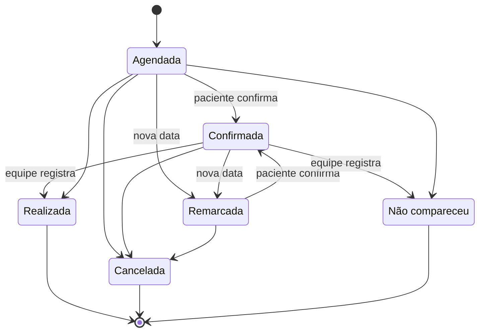
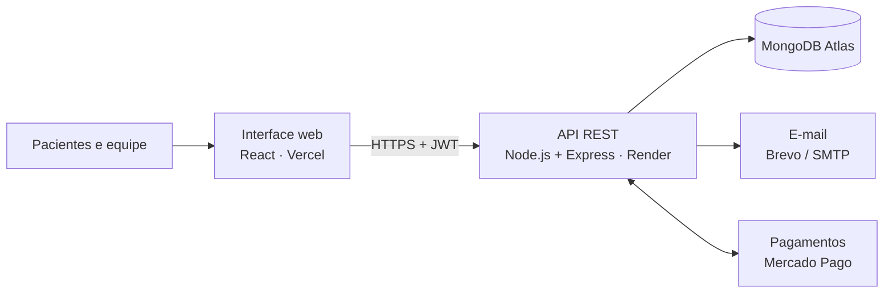
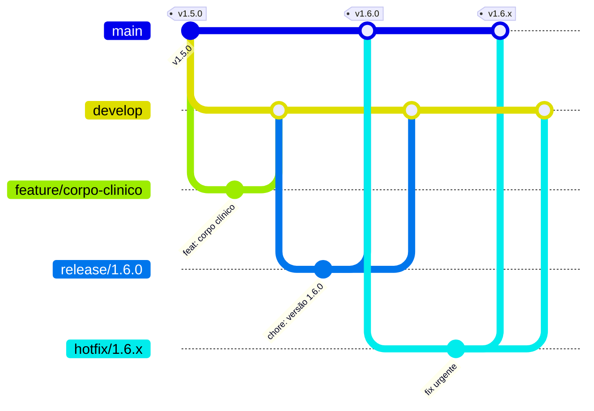

<div align="center">

# Gestão de Consultas · API

**Plataforma de agendamento e gestão de consultas para clínicas médicas**

Projeto Integrador · SENAI


[Site](https://gestao-consultas.vercel.app) · [API](https://clinica-senai-api.onrender.com) · [Interface web](https://github.com/clinica-consulta/clinica-frontend) · [Versões](https://github.com/clinica-consulta/clinica-backend/releases)

</div>

---

## Sobre o projeto

A **Gestão de Consultas** centraliza o dia a dia de uma clínica médica: marcação de consultas, agenda dos médicos, cadastro de pacientes, convênios, lembretes e documentos médicos. O objetivo é organizar a agenda, evitar horários duplicados e **reduzir as faltas** com confirmações e lembretes.

Este repositório é a **API REST** da plataforma. Ela guarda os dados, aplica as regras de negócio e controla o que cada perfil pode fazer. A interface usada por pacientes e pela equipe está em [clinica-frontend](https://github.com/clinica-consulta/clinica-frontend).

## Perfis de acesso

| Perfil | Quem é | O que faz |
|---|---|---|
| **Paciente** | Quem se cadastra pelo site ou pela recepção | Agenda, confirma, remarca e cancela as próprias consultas, paga a consulta particular e recebe avisos e documentos |
| **Recepção** | Equipe de atendimento | Cadastra pacientes e médicos, agenda pela clínica, envia lembretes, cuida da fila de espera e dos bloqueios de agenda |
| **Profissional** | Médico do corpo clínico | Vê a própria agenda e os pacientes, registra atendimento ou ausência e envia atestados e receitas |
| **Administrador** | Gestão da clínica | Tudo o que a recepção faz, mais equipe interna, especialidades, convênios, expedientes, configurações e relatórios |

## Funcionalidades

### Acesso e conta
- Login com e-mail e senha, com sessão por token JWT e senhas guardadas com hash.
- Cadastro público do paciente, com validação de CPF e escolha do convênio.
- Cada pessoa edita o próprio nome e telefone e troca a própria senha.
- Redefinição de senha por **código de 6 dígitos** enviado por e-mail, válido por 15 minutos, com até 5 tentativas e confirmação de CPF.

### Pacientes
- Cadastro completo (nome, CPF, nascimento, contato e convênio) feito pelo paciente ou pela equipe.
- O paciente enxerga e altera somente a própria ficha.
- Desativar um paciente preserva o histórico e impede novos agendamentos.

### Corpo clínico
- Cadastro de médicos com especialidade, CRM, contato e cor na agenda; cada médico recebe um acesso próprio.
- **12 especialidades** com 2 médicos cada: Clínica geral, Cardiologia, Pediatria, Dermatologia, Ortopedia, Ginecologia, Oftalmologia, Neurologia, Psiquiatria, Endocrinologia, Otorrinolaringologia e Urologia.
- Especialidades e convênios gerenciados pelo administrador; cada convênio define as especialidades que cobre.
- Exclusão de médico cadastrado por engano, permitida só quando ele não tem consultas.

### Agenda
- Expediente semanal de cada médico, dia a dia.
- Bloqueio de um horário ou de um período inteiro (férias, congressos, manutenção).
- Cálculo automático dos **horários livres de 30 em 30 minutos**, descontando consultas e bloqueios; no dia de hoje só aparecem horários futuros.

### Consultas
- Agendamento pelo paciente ou pela recepção, com **código sequencial** e registro do canal de origem.
- Verificação de **elegibilidade** antes de agendar: paciente ativo, especialidade ativa e coberta pelo convênio.
- Confirmação, remarcação e cancelamento; cancelar libera o horário na hora.
- Registro de consulta **realizada** ou **não compareceu** pela equipe.
- **Histórico de alterações** de cada consulta, com data e autor.
- Filtros por data, período, médico, paciente, status e especialidade.

### Pagamentos
- Cobrança da consulta do convênio **Particular**, gerada quando a consulta é registrada como realizada, com o valor definido nas configurações da clínica.
- O paciente recebe um aviso no portal (e por e-mail, se configurado) e paga com Pix, cartão de crédito ou cartão de débito pelo **Mercado Pago** (Checkout Pro).
- A confirmação chega pelo webhook do Mercado Pago e também é conferida quando o paciente volta ao site. O valor pago é comparado com o cobrado.
- A recepção pode registrar pagamentos feitos no balcão. Sem `MP_ACCESS_TOKEN`, o pagamento do paciente funciona em modo simulado.

### Notificações e lembretes
- Central de avisos por perfil, por paciente ou por médico, com controle de lidos e não lidos.
- Avisos automáticos em agendamentos, confirmações, remarcações, cancelamentos, pagamentos, convites da fila de espera e bloqueios de agenda.
- **Lembretes** de consulta individuais ou em lote, no máximo um por consulta.
- Envio de e-mail pela API do Brevo ou por SMTP.

### Documentos médicos
- O médico envia **atestado** ou **receita** ao paciente, que recebe nas notificações e pode imprimir.

### ⏳ Fila de espera
- Pacientes aguardando vaga por especialidade, com prioridade **Alta** ou **Normal**.
- Convite ao paciente quando um horário abre.

### Relatórios e administração
- Indicadores do painel: consultas por status, presença, faltas, cancelamentos, movimento da semana e ocupação da agenda de cada médico.
- Gestão da equipe interna (recepção e administradores).
- Configurações da clínica: nome, CNPJ, contato, antecedência do lembrete, confirmação automática e valor da consulta particular.

## Regras de negócio

| Regra | Como funciona |
|---|---|
| Horários | Intervalos de 30 minutos dentro do expediente, sem consultas ativas nem bloqueios |
| Agendamento | Só com paciente ativo, especialidade ativa e coberta pelo convênio |
| Cancelamento | Libera o horário imediatamente para outro paciente |
| Remarcação | A confirmação volta para "Sem resposta" até o paciente confirmar a nova data |
| Lembrete | Um único lembrete por consulta |
| Pagamento | Só para o convênio Particular e depois da consulta realizada |
| Desativação | Paciente, médico ou especialidade desativados mantêm o histórico e deixam de aceitar agendamentos |
| Exclusão de médico | Permitida apenas sem consultas registradas |
| Histórico | Toda alteração da consulta fica registrada |

### Ciclo da consulta



## Arquitetura



| Camada | Tecnologia |
|---|---|
| Servidor | Node.js 20 e Express 5 |
| Banco de dados | MongoDB com Mongoose (MongoDB Atlas em produção) |
| Segurança | JWT para sessões e bcrypt para senhas |
| E-mail | API do Brevo ou SMTP (Nodemailer) |
| Pagamentos | Mercado Pago (Checkout Pro e webhook) |
| Testes | node:test e supertest |
| Hospedagem | Render |

### Organização do código

```
src/
├── app.js          Express, middlewares e rotas
├── server.js       Conexão com o banco e início do servidor
├── config/         Conexão e padrão de JSON do Mongoose
├── controllers/    Regras de cada recurso
├── middlewares/    Autenticação, permissões e tratamento de erros
├── models/         Coleções do MongoDB
├── routes/         Rotas da API (/api/...)
├── services/       Agenda, notificações e e-mail
├── seed/           Preparação do banco e corpo clínico
└── utils/          Datas, CPF, textos e erros
tests/              Testes de integração
```

### Coleções

| Coleção | Guarda |
|---|---|
| Usuários | Acessos de todos os perfis |
| Pacientes | Ficha do paciente e convênio |
| Profissionais | Médicos, especialidade e expediente semanal |
| Consultas | Agendamentos, status, histórico e pagamento |
| Bloqueios | Horários e períodos indisponíveis |
| Especialidades e Convênios | Catálogos da clínica e coberturas |
| Fila de espera | Pacientes aguardando vaga |
| Notificações | Avisos, lembretes e documentos |
| Configurações | Dados e preferências da clínica |

## Recursos da API

Todas as rotas ficam em `/api`. As públicas são login, cadastro, recuperação de senha e as listas de especialidades e convênios; as demais exigem o token da sessão.

| Recurso | Rota | Principais ações |
|---|---|---|
| Acesso | `/auth` | login, cadastro, recuperar e redefinir senha, minha conta |
| Pacientes | `/pacientes` | listar, cadastrar, editar, ativar e desativar |
| Profissionais | `/profissionais` | listar, cadastrar, editar, expediente, ativar, excluir |
| Bloqueios | `/bloqueios` | listar, criar e remover |
| Consultas | `/consultas` | agendar, horários livres, elegibilidade, status, remarcar, lembrete, pagamento (checkout e verificação) |
| Pagamentos | `/pagamentos` | webhook do Mercado Pago e configuração do pagamento on-line (públicas) |
| Fila de espera | `/fila-espera` | adicionar, convidar e remover |
| Notificações | `/notificacoes` | listar, enviar aviso ou documento, marcar como lida |
| Especialidades | `/especialidades` | listar, cadastrar, editar e desativar |
| Convênios | `/convenios` | listar, cadastrar, editar e desativar |
| Configurações | `/configuracoes` | ler e atualizar |
| Usuários | `/usuarios` | equipe interna |
| Relatórios | `/relatorios/resumo` | indicadores do painel |

## Versões

| Versão | Destaques |
|---|---|
| [1.6.2](https://github.com/clinica-consulta/clinica-backend/releases/tag/v1.6.2) | Documentação profissional e padronização de issues, labels e cards |
| [1.6.1](https://github.com/clinica-consulta/clinica-backend/releases/tag/v1.6.1) | Documentação do projeto e padronização do git flow |
| [1.6.0](https://github.com/clinica-consulta/clinica-backend/releases/tag/v1.6.0) | Corpo clínico com 12 especialidades e envio de atestados e receitas |
| [1.5.0](https://github.com/clinica-consulta/clinica-backend/releases/tag/v1.5.0) | E-mail pela API do Brevo |
| [1.4.1](https://github.com/clinica-consulta/clinica-backend/releases/tag/v1.4.1) | Setup preserva banco já configurado |
| [1.4.0](https://github.com/clinica-consulta/clinica-backend/releases/tag/v1.4.0) | Exclusão de médico sem consultas |
| [1.3.1](https://github.com/clinica-consulta/clinica-backend/releases/tag/v1.3.1) | Publicação no Render |
| [1.3.0](https://github.com/clinica-consulta/clinica-backend/releases/tag/v1.3.0) | CPF na redefinição, pagamento só para particular e horários a partir da hora atual |
| [1.2.0](https://github.com/clinica-consulta/clinica-backend/releases/tag/v1.2.0) | Pagamento simulado, lembrete único e redefinição de senha por código |
| [1.1.0](https://github.com/clinica-consulta/clinica-backend/releases/tag/v1.1.0) | Banco da Clínica Senai com acessos iniciais |
| [1.0.0](https://github.com/clinica-consulta/clinica-backend/releases/tag/v1.0.0) | API completa: acesso, pacientes, médicos, agenda, consultas, fila, notificações e relatórios |

## Gestão do projeto

Cada funcionalidade e cada tarefa é uma issue, acompanhada no [quadro do projeto](https://github.com/orgs/clinica-consulta/projects/3).

**Títulos.** Seguem o formato `[MÓDULO-NN-BE] Descrição`, por exemplo `[CON-03-BE] Remarcação de consulta`. O sufixo `BE` indica o repositório. Cada módulo tem um épico, `[EP-MÓDULO]`, que reúne suas tarefas como sub-issues e mostra o progresso.

| Módulo | Escopo |
|---|---|
| `AUTH` | Acesso e autenticação |
| `PAC` | Gestão de pacientes |
| `MED` | Corpo clínico, especialidades e convênios |
| `AGE` | Agenda e disponibilidade |
| `CON` | Agendamento e ciclo da consulta |
| `PAG` | Pagamento da consulta particular |
| `NOT` | Notificações, lembretes e e-mail |
| `FIL` | Fila de espera |
| `DOC` | Documentos médicos |
| `REL` | Relatórios e indicadores |
| `ADM` | Administração da clínica |
| `PLT` | Plataforma, qualidade e entrega |

**Labels.**

| Label | Uso |
|---|---|
| `priority:P0`, `P1`, `P2` | Prioridade: crítica, alta e normal |
| `release:vX.Y.Z` | Versão em que a tarefa foi ou será entregue; `release:backlog` quando ainda não há versão |
| `squad:*` | Área responsável: backend, frontend, database, cloud, quality ou product |
| `type:*` | Natureza: epic, task, bug, hotfix ou docs |
| `S0` a `S3` | Estimativa de tamanho, do menor ao maior |

**Milestones.** Há um milestone por versão. O milestone Backlog guarda as ideias ainda sem versão definida.

## Fluxo de trabalho (Git Flow)



| Branch | Para que serve | Nasce de | Volta para |
|---|---|---|---|
| `main` | Versão em produção, cada entrega com uma tag `vX.Y.Z` | | |
| `develop` | Integração do que está pronto | `main` | |
| `feature/nome` | Uma funcionalidade nova | `develop` | `develop` |
| `bugfix/nome` | Correção que pode esperar a próxima versão | `develop` | `develop` |
| `release/X.Y.Z` | Preparação da versão (número e ajustes finais) | `develop` | `main` e `develop` |
| `hotfix/X.Y.Z` | Correção urgente em produção | `main` | `main` e `develop` |
| `docs/nome` | Documentação | `develop` | `develop` |

- Versões seguem o [versionamento semântico](https://semver.org/lang/pt-BR/): `MAIOR.MENOR.CORREÇÃO`.
- Commits seguem o padrão `tipo: descrição` com os tipos `feat`, `fix`, `docs`, `test` e `chore`.
- Cada tarefa tem uma issue, com o padrão descrito em Gestão do projeto, e fica no milestone da versão em que foi entregue.

---

<div align="center">

Guia técnico para rodar e publicar a API: [docs/desenvolvimento.md](docs/desenvolvimento.md)

</div>
