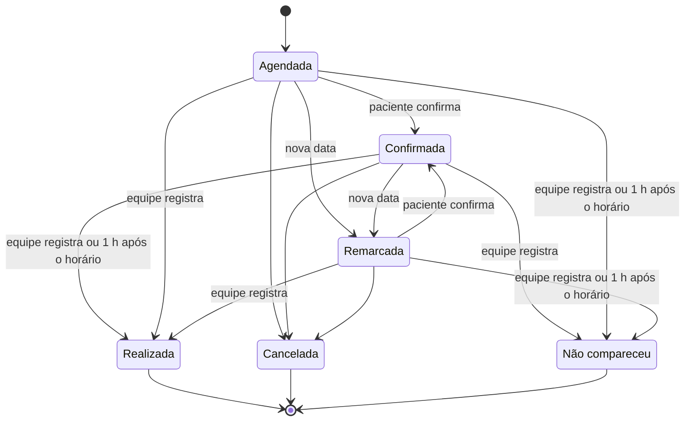
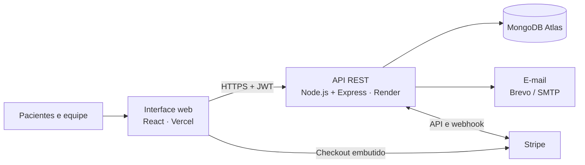
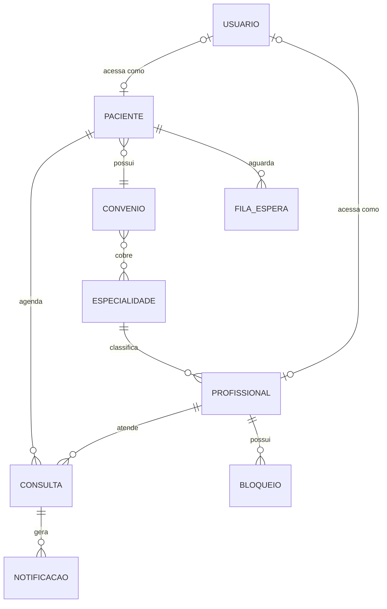
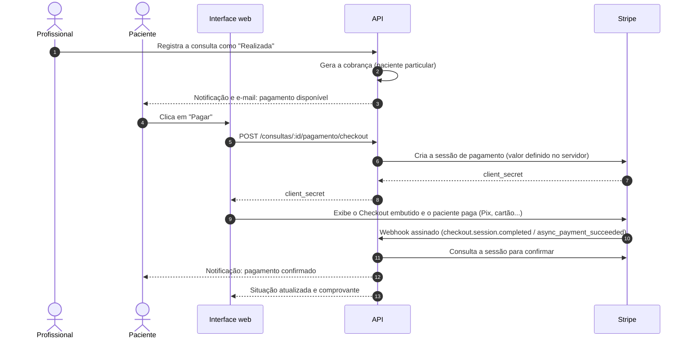
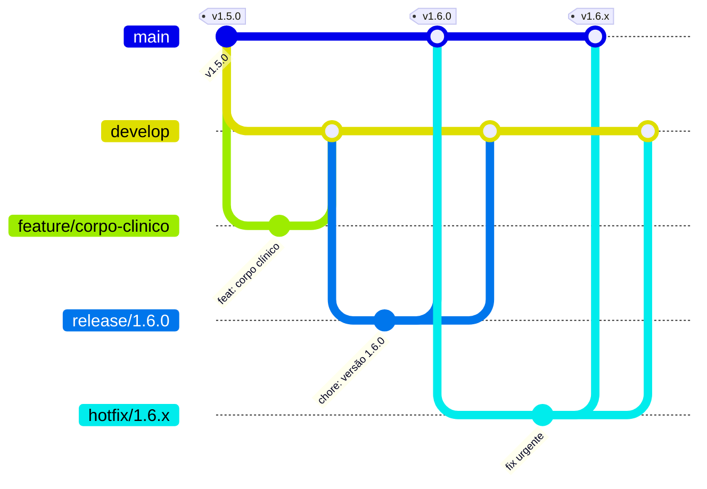

<div align="center">

# Gestão de Consultas: API REST para Agendamento e Gestão de Consultas em Clínicas Médicas

**Projeto Integrador · SENAI**


[Site](https://gestao-consultas.vercel.app) · [API](https://clinica-senai-api.onrender.com) · [Interface web](https://github.com/clinica-consulta/clinica-frontend) · [Versões](https://github.com/clinica-consulta/clinica-backend/releases) · [Quadro do projeto](https://github.com/orgs/clinica-consulta/projects/3)

</div>

---

## Sumário

1. [Identificação](#1-identificação)
2. [Resumo](#2-resumo)
3. [Introdução](#3-introdução)
4. [Objetivos](#4-objetivos)
5. [Metodologia](#5-metodologia)
6. [Requisitos do sistema](#6-requisitos-do-sistema)
7. [Arquitetura e tecnologias](#7-arquitetura-e-tecnologias)
8. [Modelagem de dados](#8-modelagem-de-dados)
9. [Especificação da API](#9-especificação-da-api)
10. [Pagamentos on-line](#10-pagamentos-on-line)
11. [Segurança e proteção de dados](#11-segurança-e-proteção-de-dados)
12. [Testes e qualidade](#12-testes-e-qualidade)
13. [Implantação](#13-implantação)
14. [Resultados e versões](#14-resultados-e-versões)
15. [Considerações finais e trabalhos futuros](#15-considerações-finais-e-trabalhos-futuros)
16. [Referências](#16-referências)
- [Apêndice A: gestão do projeto](#apêndice-a-gestão-do-projeto)
- [Apêndice B: fluxo de trabalho (Git Flow)](#apêndice-b-fluxo-de-trabalho-git-flow)

---

## 1. Identificação

| Item | Descrição |
|---|---|
| **Título** | Gestão de Consultas: API REST para agendamento e gestão de consultas em clínicas médicas |
| **Natureza** | Projeto Integrador |
| **Instituição** | SENAI |
| **Repositório** | `clinica-consulta/clinica-backend` (API) |
| **Repositório complementar** | [`clinica-consulta/clinica-frontend`](https://github.com/clinica-consulta/clinica-frontend) (interface web) |

**Equipe**

| Integrante | GitHub |
|---|---|
| Marco Antônio | [@mocotoTonin](https://github.com/mocotoTonin) |
| João Alexandre | [@joaoalex4ndr3](https://github.com/joaoalex4ndr3) |
| Rafaela Silva da Paz | [@Blightpb](https://github.com/Blightpb) |
| Luis Felipe Correia | [@LuisFelipeCorreia](https://github.com/LuisFelipeCorreia) |
| Tuanny Thomazelli | [@TuannyThomazelli](https://github.com/TuannyThomazelli) |

---

## 2. Resumo

Este trabalho apresenta o desenvolvimento da camada de serviços da plataforma **Gestão de Consultas**, um sistema web destinado a clínicas médicas de pequeno e médio porte. A solução centraliza o agendamento de consultas, a agenda dos profissionais de saúde, o cadastro de pacientes e convênios, a comunicação com os pacientes e a cobrança das consultas particulares. A API foi construída em Node.js com o framework Express e persistência em MongoDB, seguindo o estilo arquitetural REST, com autenticação por token JWT e controle de acesso por perfil (paciente, recepção, profissional e administrador). O sistema aplica regras de negócio que impedem conflitos de horário, verificam a cobertura do convênio antes do agendamento e registram o histórico de cada consulta. Para reduzir as faltas, foram implementados confirmação de presença, lembretes e notificações. A cobrança da consulta particular é feita por meio do gateway Stripe, com Pix, cartão e boleto, sem que os dados de pagamento passem pelo servidor da clínica. A API conta com testes automatizados de integração e está publicada em ambiente de nuvem.

**Palavras-chave:** agendamento de consultas; API REST; Node.js; MongoDB; gestão de clínicas; pagamentos on-line.

---

## 3. Introdução

### 3.1 Contextualização

Em clínicas médicas, a marcação de consultas ainda é feita com frequência por telefone, planilhas ou agendas de papel. Esse modelo depende da disponibilidade da recepção, dificulta a visualização dos horários livres e favorece erros como **horários duplicados**, **agendamentos fora da cobertura do convênio** e **perda do histórico** das alterações.

### 3.2 Problema

Duas dificuldades se destacam no dia a dia das clínicas:

1. **Faltas (absenteísmo):** pacientes que não comparecem e não avisam deixam horários ociosos que poderiam atender outras pessoas.
2. **Falta de centralização:** agenda, cadastro, comunicação e cobrança ficam em ferramentas separadas, o que gera retrabalho e informações desencontradas.

### 3.3 Justificativa

Uma plataforma única, acessível pela internet, permite que o próprio paciente veja os horários livres e agende em poucos passos, enquanto a equipe acompanha a agenda em tempo real. Mecanismos de confirmação, lembrete e fila de espera ajudam a reduzir as faltas e a reaproveitar horários cancelados. A cobrança on-line da consulta particular encerra o ciclo de atendimento dentro da própria plataforma.

### 3.4 Escopo deste repositório

Este repositório contém a **API REST**, responsável por armazenar os dados, aplicar as regras de negócio e controlar as permissões de cada perfil. A interface utilizada por pacientes e pela equipe está no repositório [clinica-frontend](https://github.com/clinica-consulta/clinica-frontend).

---

## 4. Objetivos

### 4.1 Objetivo geral

Desenvolver uma API REST que dê suporte ao agendamento e à gestão de consultas de uma clínica médica, garantindo a integridade da agenda, o controle de acesso por perfil e a comunicação com o paciente do agendamento ao pagamento.

### 4.2 Objetivos específicos

- Modelar os dados de pacientes, profissionais, especialidades, convênios, consultas e notificações.
- Implementar autenticação segura e autorização por perfil de acesso.
- Calcular automaticamente os horários livres de cada profissional, considerando expediente, consultas e bloqueios.
- Validar a elegibilidade do paciente (situação cadastral e cobertura do convênio) antes do agendamento.
- Registrar o ciclo de vida da consulta e o histórico de alterações.
- Oferecer confirmação de presença, lembretes, fila de espera e notificações para reduzir faltas.
- Integrar um gateway de pagamento para a cobrança da consulta particular.
- Garantir a qualidade do código com testes automatizados de integração.
- Publicar a API em ambiente de nuvem.

---

## 5. Metodologia

O desenvolvimento seguiu uma abordagem **iterativa e incremental**, com entregas versionadas e acompanhamento das tarefas em quadro Kanban.

| Prática | Aplicação no projeto |
|---|---|
| **Planejamento por issues** | Cada funcionalidade é uma issue com código padronizado (ex.: `[CON-03-BE]`), agrupada em épicos por módulo. Ver [Apêndice A](#apêndice-a-gestão-do-projeto). |
| **Quadro Kanban** | Acompanhamento no [GitHub Projects](https://github.com/orgs/clinica-consulta/projects/3), com as colunas Backlog, To do, In progress, In review e Done. |
| **Controle de versão** | Git com o modelo **Git Flow** e revisão por pull request. Ver [Apêndice B](#apêndice-b-fluxo-de-trabalho-git-flow). |
| **Versionamento semântico** | Entregas identificadas por `MAIOR.MENOR.CORREÇÃO` e publicadas como releases. |
| **Padrão de commits** | Mensagens no formato `tipo: descrição` (`feat`, `fix`, `docs`, `test`, `chore`). |
| **Testes automatizados** | Testes de integração executados a cada mudança relevante. |

---

## 6. Requisitos do sistema

### 6.1 Perfis de acesso (atores)

| Perfil | Descrição | Responsabilidades |
|---|---|---|
| **Paciente** | Pessoa atendida pela clínica | Agenda, confirma, remarca e cancela as próprias consultas, paga a consulta particular e recebe avisos e documentos |
| **Recepção** | Equipe de atendimento | Cadastra pacientes e médicos, agenda pela clínica, envia lembretes, administra a fila de espera e os bloqueios de agenda |
| **Profissional** | Médico do corpo clínico | Consulta a própria agenda e os pacientes, registra atendimento ou ausência e emite atestados e receitas |
| **Administrador** | Gestão da clínica | Todas as ações da recepção, além de equipe interna, especialidades, convênios, expedientes, configurações e relatórios |

### 6.2 Requisitos funcionais

| Código | Requisito |
|---|---|
| RF01 | Autenticar usuários por e-mail e senha, com sessão por token JWT. |
| RF02 | Permitir o cadastro público do paciente, com validação de CPF e escolha do convênio. |
| RF03 | Permitir que cada usuário edite os próprios dados e troque a senha. |
| RF04 | Redefinir a senha por código de 6 dígitos enviado por e-mail, com validade de 15 minutos, limite de tentativas e confirmação de CPF. |
| RF05 | Manter o cadastro de pacientes, com ativação e desativação que preservam o histórico. |
| RF06 | Manter o cadastro de profissionais, com especialidade, CRM, contato, expediente semanal e acesso próprio. |
| RF07 | Manter os catálogos de especialidades e convênios, incluindo as especialidades cobertas por cada convênio. |
| RF08 | Registrar bloqueios de agenda por horário ou por período. |
| RF09 | Calcular os horários livres de cada profissional em intervalos de 30 minutos. |
| RF10 | Verificar a elegibilidade do paciente antes do agendamento. |
| RF11 | Agendar, confirmar, remarcar e cancelar consultas, com código sequencial e canal de origem. |
| RF12 | Registrar a consulta como realizada ou como não comparecimento. |
| RF13 | Manter o histórico de alterações de cada consulta. |
| RF14 | Gerar a cobrança da consulta particular após a realização e permitir o pagamento on-line por Pix, cartão ou boleto. |
| RF15 | Permitir que a recepção registre pagamentos feitos presencialmente. |
| RF16 | Enviar notificações por perfil, por paciente ou por profissional, com controle de leitura. |
| RF17 | Enviar lembretes de consulta individuais ou em lote. |
| RF18 | Manter a fila de espera por especialidade, com prioridade e convite quando um horário for liberado. |
| RF19 | Permitir que o profissional envie atestados e receitas ao paciente. |
| RF20 | Disponibilizar indicadores de consultas, presença, faltas, cancelamentos e ocupação da agenda. |
| RF21 | Manter as configurações da clínica, como dados cadastrais e valor da consulta particular. |

### 6.3 Requisitos não funcionais

| Código | Requisito |
|---|---|
| RNF01 | **Segurança:** senhas armazenadas com hash bcrypt; rotas protegidas por token JWT e por perfil. |
| RNF02 | **Privacidade:** cada perfil acessa somente os dados que lhe dizem respeito, conforme a LGPD (Lei nº 13.709/2018). |
| RNF03 | **Pagamentos:** dados de cartão e de pagamento não trafegam nem são armazenados no servidor da clínica. |
| RNF04 | **Interoperabilidade:** comunicação em JSON sobre HTTPS, no estilo REST. |
| RNF05 | **Disponibilidade:** API publicada em nuvem (Render) e banco gerenciado (MongoDB Atlas). |
| RNF06 | **Manutenibilidade:** código organizado em camadas (rotas, controladores, serviços e modelos). |
| RNF07 | **Qualidade:** testes automatizados de integração cobrindo os fluxos principais. |
| RNF08 | **Rastreabilidade:** alterações de consultas registradas com data e descrição. |

### 6.4 Regras de negócio

| Código | Regra |
|---|---|
| RN01 | Os horários são oferecidos em intervalos de 30 minutos, dentro do expediente e sem consultas ativas ou bloqueios. |
| RN02 | No dia corrente, só são oferecidos horários posteriores à hora atual. |
| RN03 | O agendamento exige paciente ativo e especialidade ativa e coberta pelo convênio. |
| RN04 | O cancelamento libera o horário imediatamente. |
| RN05 | Após a remarcação, a confirmação volta para "Sem resposta" até o paciente confirmar a nova data. |
| RN06 | Cada consulta recebe, no máximo, um lembrete. |
| RN07 | A cobrança é gerada somente para pacientes do convênio Particular e somente após a consulta realizada. |
| RN08 | O valor cobrado é definido no servidor; pagamento com valor inferior ao cobrado não é aceito. |
| RN09 | Pacientes, profissionais e especialidades desativados mantêm o histórico e deixam de aceitar agendamentos. |
| RN10 | Um profissional só pode ser excluído se não tiver consultas registradas. |
| RN11 | Antes do horário marcado, a consulta pode ser confirmada, lembrada, remarcada ou cancelada. Do horário até 1 hora depois, só pode ser registrada como realizada ou como não comparecimento. |
| RN12 | Sem resultado registrado, a consulta é encerrada automaticamente 1 hora após o horário: confirmada vira "Realizada" (com cobrança do particular); sem confirmação vira "Não compareceu". |
| RN13 | Consulta encerrada não pode mais ser alterada; a única ação permitida é lembrar o pagamento pendente do particular, no máximo uma vez a cada 24 horas. |
| RN14 | O paciente que não comparece recebe um aviso no portal e por e-mail convidando a agendar um novo horário. |

### 6.5 Ciclo de vida da consulta



---

## 7. Arquitetura e tecnologias

### 7.1 Visão geral

A plataforma adota uma arquitetura **cliente-servidor** em três camadas: a interface web (cliente), a API REST (servidor de aplicação) e o banco de dados. Serviços externos complementam a solução para envio de e-mail e processamento de pagamentos.



### 7.2 Tecnologias

| Camada | Tecnologia | Justificativa |
|---|---|---|
| Ambiente de execução | Node.js 20+ | JavaScript no servidor, com grande ecossistema e boa performance para operações de E/S |
| Framework web | Express 5 | Simplicidade na definição de rotas e middlewares |
| Banco de dados | MongoDB com Mongoose | Modelo de documentos flexível e validação de esquema na aplicação |
| Autenticação | JSON Web Token (JWT) e bcrypt | Sessão sem estado e armazenamento seguro de senhas |
| E-mail | API do Brevo ou SMTP (Nodemailer) | Envio de códigos de redefinição e avisos de cobrança |
| Pagamentos | Stripe (Checkout embutido e webhooks) | Pix, cartão e boleto com conformidade PCI garantida pelo gateway |
| Testes | `node:test` e Supertest | Testes de integração sem dependências pesadas |
| Hospedagem | Render e MongoDB Atlas | Publicação contínua e banco gerenciado |

### 7.3 Organização do código

O código segue a separação em camadas: as **rotas** definem os caminhos e as permissões, os **controladores** tratam as requisições, os **serviços** concentram as regras reutilizáveis e as integrações externas e os **modelos** descrevem as coleções.

```
src/
├── app.js          Configuração do Express, middlewares e rotas
├── server.js       Conexão com o banco e início do servidor
├── config/         Conexão e padrão de serialização do Mongoose
├── controllers/    Tratamento das requisições de cada recurso
├── middlewares/    Autenticação, permissões e tratamento de erros
├── models/         Esquemas das coleções do MongoDB
├── routes/         Rotas da API (/api/...)
├── services/       Agenda, notificações, e-mail e pagamentos (Stripe)
├── seed/           Preparação do banco e corpo clínico
└── utils/          Datas, CPF, textos e erros
tests/              Testes de integração
docs/               Guia técnico de desenvolvimento e implantação
```

---

## 8. Modelagem de dados

### 8.1 Coleções

| Coleção | Conteúdo |
|---|---|
| `usuarios` | Acessos de todos os perfis, com senha em hash |
| `pacientes` | Ficha do paciente (nome, CPF, contato, nascimento) e convênio |
| `profissionais` | Médicos, especialidade, CRM e expediente semanal |
| `consultas` | Agendamentos, status, histórico de alterações e dados do pagamento |
| `bloqueios` | Horários e períodos indisponíveis |
| `especialidades` | Catálogo de especialidades da clínica |
| `convenios` | Convênios e especialidades cobertas |
| `fila_espera` | Pacientes aguardando vaga, com prioridade |
| `notificacoes` | Avisos, lembretes e documentos médicos |
| `configuracoes` | Dados e preferências da clínica |
| `contadores` | Sequência dos códigos das consultas |

### 8.2 Relacionamentos principais



### 8.3 Dados de pagamento da consulta

| Campo | Descrição |
|---|---|
| `status` | `Pendente` ou `Pago` (vazio quando não há cobrança) |
| `valor` | Valor cobrado, definido nas configurações da clínica |
| `metodo` | Forma de pagamento utilizada (Pix, cartão de crédito, boleto...) |
| `gateway` | `Stripe` (on-line) ou `Recepção` (presencial) |
| `sessaoId`, `transacaoId` | Identificadores da sessão e do pagamento no Stripe |
| `situacaoGateway` | Situação no gateway, como "aguardando confirmação" para Pix ou boleto |
| `codigo`, `pagoEm` | Comprovante e data do pagamento |

---

## 9. Especificação da API

Todas as rotas ficam sob o prefixo `/api` e trocam dados em JSON. São públicas as rotas de login, cadastro, recuperação de senha, as listas de especialidades e convênios e as rotas de pagamento destinadas ao gateway. As demais exigem o cabeçalho `Authorization: Bearer <token>`.

| Recurso | Rota | Principais operações |
|---|---|---|
| Acesso | `/auth` | login, cadastro, recuperação e redefinição de senha, dados da conta |
| Pacientes | `/pacientes` | listar, cadastrar, editar, ativar e desativar |
| Profissionais | `/profissionais` | listar, cadastrar, editar, expediente, ativar e excluir |
| Bloqueios | `/bloqueios` | listar, criar e remover |
| Consultas | `/consultas` | agendar, horários livres, elegibilidade, status, remarcar, lembrete e pagamento |
| Pagamentos | `/pagamentos` | webhook do Stripe e configuração do pagamento on-line |
| Fila de espera | `/fila-espera` | adicionar, convidar e remover |
| Notificações | `/notificacoes` | listar, enviar aviso ou documento, marcar como lida |
| Especialidades | `/especialidades` | listar, cadastrar, editar e desativar |
| Convênios | `/convenios` | listar, cadastrar, editar e desativar |
| Configurações | `/configuracoes` | consultar e atualizar |
| Usuários | `/usuarios` | gestão da equipe interna |
| Relatórios | `/relatorios/resumo` | indicadores do painel |

**Rotas de pagamento**

| Método | Rota | Descrição |
|---|---|---|
| `POST` | `/api/consultas/:id/pagamento/checkout` | Abre a sessão de pagamento do Stripe e devolve o `client_secret` para o Checkout embutido |
| `POST` | `/api/consultas/:id/pagamento/verificar` | Consulta o Stripe e atualiza a situação do pagamento |
| `POST` | `/api/consultas/:id/pagamento` | Registro de pagamento presencial pela recepção |
| `POST` | `/api/pagamentos/webhook` | Recebe os eventos do Stripe, com assinatura verificada |
| `GET` | `/api/pagamentos/config` | Informa se o pagamento on-line está ativo |

---

## 10. Pagamentos on-line

A cobrança da consulta particular é processada pelo **Stripe**, utilizando o **Checkout embutido** (*embedded checkout*). O formulário de pagamento é exibido dentro do próprio site, sem redirecionar o paciente para outra página, e apresenta as formas de pagamento ativas na conta da clínica, como **Pix**, **cartão de crédito e débito**, **boleto** e carteiras digitais.



**Decisões de projeto**

- **Valor definido no servidor:** o cliente nunca informa o valor; a API cria a sessão com o valor configurado pela clínica.
- **Dados sensíveis fora do servidor:** os dados de cartão são digitados em um componente do próprio Stripe, o que reduz o escopo de conformidade PCI DSS da clínica.
- **Confirmação por webhook:** a confirmação não depende do navegador do paciente. O webhook tem a assinatura verificada e a sessão é sempre consultada novamente na API do Stripe.
- **Métodos assíncronos:** Pix e boleto podem ser compensados depois; nesse intervalo, a consulta permanece como "aguardando confirmação".
- **Idempotência:** eventos repetidos não geram pagamento em duplicidade.
- **Modo de demonstração:** sem as chaves do Stripe configuradas, o pagamento do paciente funciona em modo simulado.

---

## 11. Segurança e proteção de dados

| Aspecto | Medida adotada |
|---|---|
| Senhas | Armazenadas com hash bcrypt, nunca em texto puro |
| Sessão | Token JWT assinado e com prazo de expiração |
| Autorização | Middleware de permissão por perfil em cada rota |
| Isolamento de dados | Paciente e profissional acessam apenas os próprios registros |
| Redefinição de senha | Código de uso único armazenado em hash, com validade de 15 minutos e limite de tentativas |
| Pagamentos | Dados de cartão processados exclusivamente pelo Stripe; webhook com verificação de assinatura |
| Segredos | Chaves e senhas em variáveis de ambiente, fora do repositório |
| CORS | Origens permitidas configuráveis por variável de ambiente |
| LGPD | Coleta limitada aos dados necessários ao atendimento e preservação do histórico em vez de exclusão |

---

## 12. Testes e qualidade

Os testes de integração, escritos com `node:test` e Supertest, executam a API completa sobre um banco de dados de teste separado. Os serviços externos (Stripe e e-mail) são simulados, de modo que nenhuma chamada sai para a internet durante os testes.

| Área | Exemplos de cenários verificados |
|---|---|
| Autenticação | Senha incorreta, rotas sem token, cadastro de paciente |
| Agenda | Horários livres, bloqueios e horários já passados |
| Consultas | Agendamento, elegibilidade, conflito de horário, remarcação e cancelamento |
| Pagamentos | Cobrança apenas para particular; fluxo Stripe com Pix pendente e compensado; webhook repetido; assinatura inválida |
| Dados iniciais | Preparação do banco e atualização do corpo clínico |

Execução:

```bash
npm test
```

---

## 13. Implantação

| Componente | Serviço |
|---|---|
| API | [Render](https://clinica-senai-api.onrender.com) (configuração em `render.yaml`) |
| Banco de dados | MongoDB Atlas |
| Interface web | [Vercel](https://gestao-consultas.vercel.app) |
| Pagamentos | Stripe |
| E-mail | Brevo |

As variáveis de ambiente, a preparação do banco e a configuração do Stripe estão descritas no guia técnico [docs/desenvolvimento.md](docs/desenvolvimento.md).

---

## 14. Resultados e versões

O projeto resultou em uma API funcional e publicada, integrada à interface web e utilizada pelos quatro perfis de acesso. As entregas foram organizadas em versões:

| Versão | Entregas |
|---|---|
| [1.9.0](https://github.com/clinica-consulta/clinica-backend/releases/tag/v1.9.0) | Ciclo da consulta: encerramento automático 1 hora após o horário, aviso de ausência e lembrete de pagamento |
| [1.8.1](https://github.com/clinica-consulta/clinica-backend/releases/tag/v1.8.1) | Setup completa cada especialidade com 2 médicos mesmo depois de renomeada |
| [1.8.0](https://github.com/clinica-consulta/clinica-backend/releases/tag/v1.8.0) | Lembrete, confirmação e registro de consulta realizada feitos uma única vez |
| [1.7.0](https://github.com/clinica-consulta/clinica-backend/releases/tag/v1.7.0) | Pagamento on-line da consulta particular pelo Stripe (Pix, cartão e boleto) e documentação no formato acadêmico |
| [1.6.2](https://github.com/clinica-consulta/clinica-backend/releases/tag/v1.6.2) | Documentação profissional e padronização de issues, labels e cards |
| [1.6.1](https://github.com/clinica-consulta/clinica-backend/releases/tag/v1.6.1) | Documentação do projeto e padronização do Git Flow |
| [1.6.0](https://github.com/clinica-consulta/clinica-backend/releases/tag/v1.6.0) | Corpo clínico com 12 especialidades e envio de atestados e receitas |
| [1.5.0](https://github.com/clinica-consulta/clinica-backend/releases/tag/v1.5.0) | E-mail pela API do Brevo |
| [1.4.1](https://github.com/clinica-consulta/clinica-backend/releases/tag/v1.4.1) | Preparação do banco preserva dados já configurados |
| [1.4.0](https://github.com/clinica-consulta/clinica-backend/releases/tag/v1.4.0) | Exclusão de médico sem consultas |
| [1.3.1](https://github.com/clinica-consulta/clinica-backend/releases/tag/v1.3.1) | Publicação no Render |
| [1.3.0](https://github.com/clinica-consulta/clinica-backend/releases/tag/v1.3.0) | CPF na redefinição de senha, cobrança só para particular e horários a partir da hora atual |
| [1.2.0](https://github.com/clinica-consulta/clinica-backend/releases/tag/v1.2.0) | Pagamento simulado, lembrete único e redefinição de senha por código |
| [1.1.0](https://github.com/clinica-consulta/clinica-backend/releases/tag/v1.1.0) | Banco da clínica com acessos iniciais |
| [1.0.0](https://github.com/clinica-consulta/clinica-backend/releases/tag/v1.0.0) | API completa: acesso, pacientes, médicos, agenda, consultas, fila, notificações e relatórios |

---

## 15. Considerações finais e trabalhos futuros

A API atende ao objetivo de centralizar o agendamento e a gestão de consultas, aplicando regras que garantem a integridade da agenda e a coerência com a cobertura dos convênios. Os mecanismos de confirmação, lembrete, fila de espera e notificação contribuem para a redução das faltas, e a integração com o Stripe permite encerrar o atendimento particular com o pagamento dentro da plataforma.

Como trabalhos futuros, destacam-se:

- Relatórios por profissional e por período, com exportação.
- Confirmação de agendamento e lembrete automático por e-mail na véspera da consulta.
- Prazo mínimo configurável para cancelamento.
- Limite de tentativas de login e renovação de sessão.
- Exportação e exclusão dos dados do paciente, ampliando o atendimento à LGPD.
- Logs estruturados, rota de saúde com verificação do banco e rotina de backup.
- Documentação interativa da API (OpenAPI).

---

## 16. Referências

BRASIL. **Lei nº 13.709, de 14 de agosto de 2018.** Lei Geral de Proteção de Dados Pessoais (LGPD). Brasília, DF: Presidência da República, 2018. Disponível em: https://www.planalto.gov.br/ccivil_03/_ato2015-2018/2018/lei/l13709.htm.

DRIESSEN, Vincent. **A successful Git branching model.** 2010. Disponível em: https://nvie.com/posts/a-successful-git-branching-model/.

EXPRESS. **Express: framework web para Node.js.** Disponível em: https://expressjs.com/.

FIELDING, Roy Thomas. **Architectural styles and the design of network-based software architectures.** 2000. Tese (Doutorado em Ciência da Informação e da Computação) – University of California, Irvine, 2000.

JONES, M.; BRADLEY, J.; SAKIMURA, N. **RFC 7519: JSON Web Token (JWT).** IETF, 2015. Disponível em: https://datatracker.ietf.org/doc/html/rfc7519.

MONGODB. **MongoDB Documentation.** Disponível em: https://www.mongodb.com/docs/.

NODE.JS. **Node.js Documentation.** Disponível em: https://nodejs.org/docs/.

PCI SECURITY STANDARDS COUNCIL. **PCI DSS: Payment Card Industry Data Security Standard.** Disponível em: https://www.pcisecuritystandards.org/.

PRESTON-WERNER, Tom. **Versionamento Semântico 2.0.0.** Disponível em: https://semver.org/lang/pt-BR/.

STRIPE. **Stripe Documentation: Embedded Checkout e webhooks.** Disponível em: https://docs.stripe.com/.

---

## Apêndice A: gestão do projeto

Cada funcionalidade e cada tarefa é registrada como issue e acompanhada no [quadro do projeto](https://github.com/orgs/clinica-consulta/projects/3).

**Padrão de títulos.** `[MÓDULO-NN-BE] Descrição`, por exemplo `[CON-03-BE] Remarcação de consulta`. O sufixo `BE` identifica o repositório da API. Cada módulo possui um épico, `[EP-MÓDULO]`, que agrupa as tarefas como sub-issues.

| Módulo | Escopo |
|---|---|
| `AUTH` | Acesso e autenticação |
| `PAC` | Gestão de pacientes |
| `MED` | Corpo clínico, especialidades e convênios |
| `AGE` | Agenda e disponibilidade |
| `CON` | Agendamento e ciclo da consulta |
| `PAG` | Pagamento da consulta particular |
| `NOT` | Notificações, lembretes e e-mail |
| `FIL` | Fila de espera |
| `DOC` | Documentos médicos |
| `REL` | Relatórios e indicadores |
| `ADM` | Administração da clínica |
| `PLT` | Plataforma, qualidade e entrega |

**Labels**

| Label | Uso |
|---|---|
| `priority:P0`, `P1`, `P2` | Prioridade: crítica, alta e normal |
| `release:vX.Y.Z` | Versão de entrega; `release:backlog` quando ainda não definida |
| `squad:*` | Área responsável: backend, frontend, database, cloud, quality ou product |
| `type:*` | Natureza: epic, task, bug, hotfix ou docs |
| `S0` a `S3` | Estimativa de tamanho, do menor ao maior |

**Milestones.** Um milestone por versão; o milestone Backlog reúne as ideias ainda sem versão.

## Apêndice B: fluxo de trabalho (Git Flow)



| Branch | Finalidade | Origem | Destino |
|---|---|---|---|
| `main` | Versão em produção, com tag `vX.Y.Z` a cada entrega | | |
| `develop` | Integração das funcionalidades concluídas | `main` | |
| `feature/nome` | Nova funcionalidade | `develop` | `develop` |
| `bugfix/nome` | Correção não urgente | `develop` | `develop` |
| `release/X.Y.Z` | Preparação da versão | `develop` | `main` e `develop` |
| `hotfix/X.Y.Z` | Correção urgente em produção | `main` | `main` e `develop` |
| `docs/nome` | Documentação | `develop` | `develop` |

---

<div align="center">

Guia técnico para executar e publicar a API: [docs/desenvolvimento.md](docs/desenvolvimento.md)

</div>
